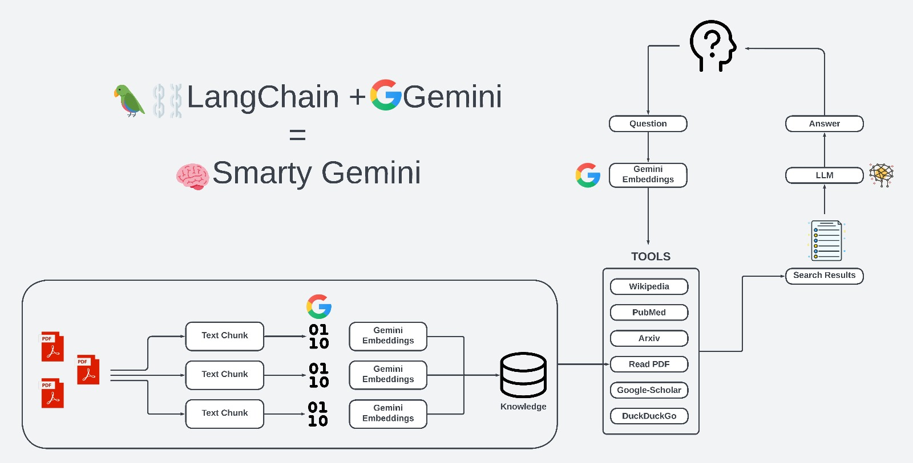

# 🧠SuperGeM

## Introduction
This is the GitHub repository of Super-GemM, a sophisticated agent designed to meet a wide array of user needs through advanced language understanding and decision-making capabilities. Powered by Google's cutting-edge Gemini 3.5 Flash Lite- Large Language Model (LLM), this agent integrates a suite of special tools to facilitate searches across various platforms including DuckDuckGo, Wikipedia, Google Scholar, ArXiv, and PubMed, alongside the capability to read and interpret PDF documents. 

Use SuperGeM now!
at https://supergem.streamlit.app/

## Screenshots

\

## Why SuperGeM

- **Free and OpenSource**
- **Better Model selection than Gemini**: While using Google models, SuperGeM supports the only default model of the Gemini free tier (Gemini 3.5 Flash-Lite) but also supports a wide vearity of other models where some like **Gemini 3.8 Flash** and **Gemma 4** can surpass the Gemini Free Tier Models by miles.
- **Multimodality**: Accepts any file you give and analyzes it, whether it's a PDF, TXT, DOCX, or image.
- **Usable anywhere**: The app is accessible in any device with a browser at https://supergem.streamlit.app/
- **Dynamic Tool Selection**: The agent autonomously decides the most suitable tool or response for each query, optimizing user experience.
- **Versatile Search Options**: With integrated search capabilities across DuckDuckGo, Wikipedia, Google Scholar, ArXiv, and PubMed, users can find accurate information across the web and academic journals.
- **Web Interface**: A user-friendly web interface built using the Streamlit library, making it accessible for non-technical users.
- **Powered by Langchain**: Utilizes the Langchain library for efficient handling of API and LLM calls.

## Installation
To get started with SuperGeM, ensure you have [Gemini API Key](https://aistudio.google.com/apikey). Use the [Website](https://supergem.streamlit.app/) or install the [Latest Windows Release](https://github.com/Mahir29Flame/SuperGeM/releases/download/v0.5.4/SuperGeM-0.5.4.exe)

## Usage
After installation, you can utilize the Gemini-Pro Agent through its Streamlit web interface. Follow these steps to start interacting with the agent:

1. **Enter your API key**: Use the sidebar field, or configure `GEMINI_API_KEY`/`GOOGLE_API_KEY` for a desktop or automated deployment.
   
Through the web interface, you can query the agent, request information from integrated search platforms, and have your PDF documents read and interpreted. The agent's advanced language understanding and decision-making capabilities will ensure you receive relevant and accurate responses.

This will start the web interface, where you can interact with the agent directly.

## How It Works

The Gemini-Pro Agent uses the Langchain library to manage API and LLM calls, enabling it to interpret queries, decide the most appropriate tool or answer, and fetch data from various sources. The agent's decision-making process and language understanding capabilities are powered by Google's Gemini-pro LLM, ensuring high-quality responses.

## Resources used in the project(by [g-hano](https://github.com/g-hano/Smarty-Gemini))

- all html-css codes are belong to [alejandro-ao](https://github.com/alejandro-ao/ask-multiple-pdfs/tree/main)

## Contributing
We welcome contributions to the Gemini-Pro Agent project. If you're interested in improving the agent or adding new features, please fork the repository and submit a pull request.

## License
[MIT License](LICENSE.md)

---
